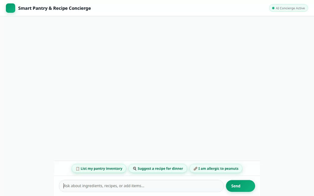

# Smart Pantry & Recipe Concierge



An intelligent conversational AI concierge built on Google's Agent Development Kit (ADK) that helps home cooks track pantry inventory, suggest safety-checked recipes based on available ingredients, generate food photography and videos, and find nearby grocery stores.

---

## 🚀 Wired Features & Google Cloud Services

This agent directly integrates with the following Google Cloud services and ADK tools based on `app/` and `agents-cli-manifest.yaml`:

### 🧠 Cross-Session Memory & Allergy Guard
- **Vertex AI Memory Bank**: Integrates `VertexAiMemoryBankService` (`PreloadMemoryTool` + `after_agent_callback`) to persist durable user memories across sessions.
- **Dietary & Allergy Screening**: Remembers dietary preferences and food allergies (e.g., peanuts, gluten, dairy) across turns and screens suggested recipes before recommending them.

### 📦 Pantry Inventory Management
- **Google Cloud Firestore Database**: Real-time CRUD operations (`get_pantry_items`, `add_or_update_pantry_item`) to track pantry items, quantities, and ingredient categories.
- **Smart Grocery List Generator**: `generate_grocery_list` compares recipe ingredient requirements against current Firestore inventory.

### 🎨 Multimodal Media Generation & Public Cloud Storage
- **Food Photo Generation**: Uses `gemini-3.1-flash-lite-image` (`generate_recipe_image`) to generate high-quality food photography.
- **Demonstration Video Generation**: Uses Google's Omni model (`gemini-omni-flash-preview`) in the `global` region (`generate_recipe_video`) to generate short cooking demonstration clips.
- **Google Cloud Storage (GCS)**: Stores generated image and video assets directly in a public Cloud Storage bucket (`smart-pantry-assets-qwiklabs-gcp-01-81ce122bf040`) and registers ADK `ToolContext` artifacts for UI rendering.

### 📍 Maps & Location Services
- **Google Maps Geocoding API**: Converts street addresses or location names into latitude/longitude coordinates (`geocode_address`).
- **Google Places API (New)**: Finds nearby grocery stores, supermarkets, and specialty food markets (`find_nearby_places`).

### 🖥️ Native A2UI Interface & Python Sandbox
- **A2UI Card Renderer**: Uses `A2uiSchemaManager` (v0.8) and `BasicCatalog` to emit structured display UI cards natively rendered in the frontend interface.
- **Code Execution**: Executes Python code in an isolated sandbox (`AgentEngineSandboxCodeExecutor`).

---

## 🔮 Planned / Not Yet Implemented

The following features were outlined in initial design concepts but are **not yet implemented** in the codebase:
- 📷 *Barcode Scanner Integration*: Scanning product barcodes via camera to auto-add items to Firestore.
- 🛒 *Automated Grocery Checkout*: Direct integration with online grocery delivery services.

---

## 🛠️ Project Structure

```
simple-agent/
├── app/
│   ├── agent.py               # Main agent logic, tools, Memory Bank, and A2UI callbacks
│   ├── a2ui_utils.py          # A2UI schema manager and card renderer callback
│   └── fast_api_app.py        # FastAPI server entrypoint
├── frontend/
│   ├── main.py                # FastAPI proxy server (browser -> A2A Agent Runtime)
│   └── static/
│       └── index.html         # Dialogue UI with Outfit font & A2UI renderer
├── assets/
│   ├── demo.gif               # Optimized looping demo GIF
│   └── demo_agent.webm        # Recorded demo video
├── agents-cli-manifest.yaml   # Agent manifest configuration
└── pyproject.toml             # Python dependencies
```

---

## 💻 Setup & Run Instructions

### Prerequisites
- Python 3.11+
- `uv` package manager (`uv tool install google-agents-cli`)
- `gcloud` CLI authenticated to your GCP project

### 1. Install Dependencies
```bash
agents-cli install
```

### 2. Local Development Server
Start the local FastAPI proxy frontend:
```bash
cd frontend
AGENT_ENGINE_RESOURCE_NAME="projects/<project-id>/locations/<region>/reasoningEngines/<agent-id>" \
AGENT_DIRECTORY="app" \
PORT=8080 \
uv run python main.py
```

### 3. Deploying to Agent Platform
Deploy the agent logic to Google Agent Platform (Vertex AI Reasoning Engine):
```bash
agents-cli deploy --project <your-gcp-project-id>
```

### 4. Deploying Frontend to Cloud Run
Deploy the frontend container to Cloud Run:
```bash
gcloud run deploy simple-agent-frontend \
  --source ./frontend \
  --region us-east1 \
  --project <your-gcp-project-id> \
  --allow-unauthenticated \
  --set-env-vars AGENT_ENGINE_RESOURCE_NAME="projects/<project-id>/locations/<region>/reasoningEngines/<agent-id>",AGENT_DIRECTORY="app"
```

Grant the Cloud Run service account permission to invoke the agent:
```bash
gcloud projects add-iam-policy-binding <your-gcp-project-id> \
  --member="serviceAccount:<project-number>-compute@developer.gserviceaccount.com" \
  --role="roles/aiplatform.user"
```
